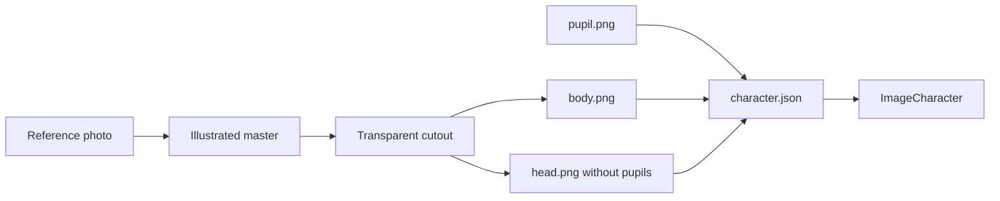

# Layered character version 2

Version 1 stays the current drawn character in [`mouse_gaze/girl.py`](mouse_gaze/girl.py). The window screenshot is archived and is not replaced. Version 2 is a separate illustrated bust, using the photo only as a likeness reference (long dark hair, bindi, maroon top, warm complexion, small earrings, soft smile). It is stylized and crisp, not a photograph, so it stays light enough for Pygame and Docker.

The loader in [`mouse_gaze/image_character.py`](mouse_gaze/image_character.py) already moves the head and pupils separately. Version 2 only needs real PNGs plus a small switch so both versions can run.

## Keep version 1

- Copy the current window screenshot to [`assets/v1/preview.png`](assets/v1/preview.png).
- Leave the procedural girl unchanged. `run.bat v1` sets `MOUSE_GAZE_VERSION=v1` and still launches her.

## Build the version 2 sprites

Generate a front-facing bust on a flat background, with the photo passed in as the reference. Eyes are brown iris rings with empty centers: no baked pupils, no catchlights in the middle. Hair, ears, brows, nose, mouth, and a small bindi stay on the head. Clothing and shoulders stay on the body. The neck overlaps both layers so an 8-degree turn does not show a gap.

Then, in Python with Pillow:

- Remove the flat background to real RGBA. No scene, no text, no watermark.
- Split into body and head. Erase any accidental pupil pixels back to the iris color.
- Draw [`assets/v2/pupil.png`](assets/v2/pupil.png) as a small high-contrast ellipse with one highlight, about 48 by 48. A drawn pupil is sharper and smaller than a generated one.
- Pad the head with transparent margin so rotation does not clip hair.
- Crop unused transparency. Save optimized PNG-32 with metadata stripped. Skin and hair gradients need RGBA; PNG-8 is used only if a side-by-side check shows no banding.
- Measure iris centers and the neck pivot from the pixels and write those numbers into config. Do not guess them from the generator canvas.

Target runtime layout for a 1280 by 720 window, refined after the crop:

- Source generation larger than the window, then downscale once into the PNGs below.
- Body about 900 by 780.
- Head about 820 by 900, including rotation margin.
- Pupil 48 by 48.
- Expected size: body and head each a few hundred kilobytes, pupil under 10 KB.
- `reference_size` is `[1280, 720]`. [`mouse_gaze/app.py`](mouse_gaze/app.py) window default changes from 960 by 720 to 1280 by 720 so the uniform scale in `ImageCharacter.on_resize` does not letterbox the portrait.
- `max_head_degrees` is 8. `head_shift` stays small, about `[12, 8]`.
- `pupil_range` is the iris radius minus the pupil radius, so the pupil stays inside the iris.

Filenames under [`assets/v2/`](assets/v2/):

- `body.png`
- `head.png`
- `pupil.png`
- `character.json`

`character.json` uses the fields the loader already requires: `reference_size`, `anchor`, `body`, `body_pos`, `head`, `head_pivot`, `head_pos`, `eyes`, `pupil`, `pupil_range`, `max_head_degrees`, `head_shift`. Paths are filenames only, because `ImageCharacter` is pointed at the `assets/v2` folder.

## Wire it into the app

- [`mouse_gaze/factory.py`](mouse_gaze/factory.py): default to version 2 when `assets/v2/character.json` exists. `MOUSE_GAZE_VERSION=v1` returns `GirlCharacter`.
- [`run.bat`](run.bat): `run.bat` launches version 2. `run.bat v1` launches the drawn character.
- [`mouse_gaze/image_character.py`](mouse_gaze/image_character.py): paint the existing warm backdrop behind the transparent sprites before the body and head. Version 1 already draws its own background; version 2 currently would composite on black.
- Docker already copies `assets/`, so the new PNGs ship with the image. No change to the Dockerfile unless the backdrop work needs none.

## Check

- Load the three PNGs with `convert_alpha()` and confirm the head has no opaque pupil.
- Render settled gazes: center, left, right, up, down. Pupils must move inside the irises, and the head must turn slightly around the neck without a seam or clipped hair.
- Confirm `run.bat v1` still shows the original drawn character.
